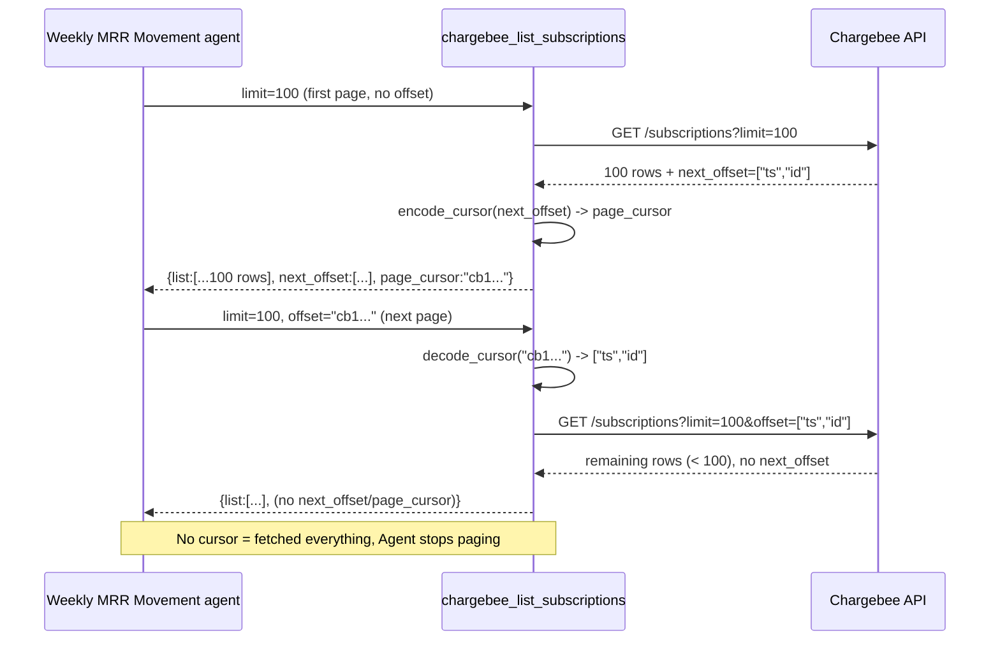
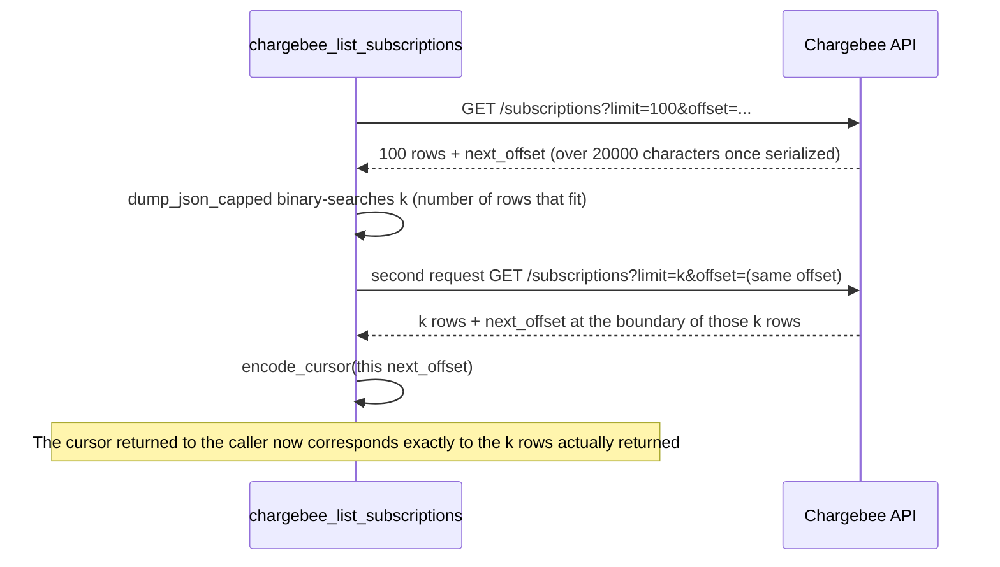

# PRD-17977 · [Bug] Chargebee MCP pagination broken

Ticket: https://app.clickup.com/t/86e3227xy
Repo: https://github.com/MSPbotsAI/chargebee-mcp@main (26950f5)
Working branch: dev01.mbagent/PRD-17977
Status: frozen @ 3032c29

## Requirement understanding

In one sentence: the Chargebee MCP does not support pagination - data beyond 100 rows cannot be fetched, so the Weekly MRR Movement agent (sopId 281) cannot produce complete billing/subscription data for a period.

Restated: the 5 list-type tools of the Chargebee MCP (`chargebee_list_customers` / `_list_customer_contacts` / `_list_subscriptions` / `_list_invoices` / `_list_transactions`) return at most 100 rows per call and include a `next_offset` cursor in the response for paging. But `next_offset` is a two-element array returned by Chargebee as-is (for example `["1666285190000","41937694"]`), while the tools' `offset` input is typed as a plain string - whether the array is passed back as-is, converted to a JSON string and passed back, or only one element of the array is passed, all fail (the first two are rejected by the MCP framework/Pydantic before reaching Chargebee; the third passes validation but is rejected by Chargebee with HTTP 400). As a result any Chargebee query with more than 100 rows can only get the first page, and row 101 onward can never be fetched. This defect is the only target of this ticket; whether to also make the tool automatically pull the complete result set in one go (the other way out in the ticket's Expected Result) depends on OQ-2, and this design does not assume it is needed for now.

Sources: description (submitted 2026-09-01) + 14 comments (including the final analysis id 90170247158457 of 2026-09-01 11:46 UTC and Kaka's request for a redo id 90170249491826 of 2026-09-08) · code verified read-only: `src/chargebee_mcp/tools/{customers,subscriptions,reports}.py`, `src/chargebee_mcp/tools/_common.py`, `src/chargebee_mcp/_json.py`, `src/chargebee_mcp/api_client.py` (all at `chargebee-mcp@main` 26950f5) · wiki: not covered by `ProductDocs` - `wiki find "MRR Movement" / "pagination" / "chargebee"` returned no hit for this tool (the only hit, `ProductDocs/_connector-fields.md`, covers credential fields in the Connector Library configuration form, a completely different module from the "Chargebee MCP pagination" in this ticket); this is a defect in an internal AI Agent platform tool and outside the scope of the customer-facing product fact base.

## Current state (every assertion carries path:line)

- The `offset` input of all 5 list tools is typed `str | None`:
  - `src/chargebee_mcp/tools/customers.py:24` (`chargebee_list_customers`)
  - `src/chargebee_mcp/tools/customers.py:190` (`chargebee_list_customer_contacts`)
  - `src/chargebee_mcp/tools/subscriptions.py:30` (`chargebee_list_subscriptions`)
  - `src/chargebee_mcp/tools/reports.py:24` (`chargebee_list_invoices`)
  - `src/chargebee_mcp/tools/reports.py:74` (`chargebee_list_transactions`)
  - The description text comes uniformly from `src/chargebee_mcp/tools/_common.py:17-22` (`OFFSET_DESC`), which says "cursor-based ... pass through a next_offset you already retrieved", but no code converts the returned `next_offset` into a form this `str` type can accept.
- `next_offset` itself is not generated by this repo; it is a raw field in the Chargebee API response body, passed through the whole chain with no processing: `src/chargebee_mcp/api_client.py:129-130` (`get()` returns the Chargebee response body as-is), `:181-187` (`_parse_body` only does `resp.json()` and does not rewrite fields). The tool functions also just hand the return value of `client.get(...)` straight to `dump_json_capped` (e.g. `subscriptions.py:66-67`), with no conversion of `next_offset`.
- The only place that processes the response body is truncation, `src/chargebee_mcp/_json.py:18-61` (`dump_json_capped`): when the serialized result exceeds `MAX_CHARS=20000` (`_json.py:11`), it binary-truncates the largest list field (`:33-52`), but **sibling keys are kept as-is** - including `next_offset`. That is, the cursor corresponding to the truncated part is not at the same position as the last row actually returned after truncation: a caller paging with this cursor silently misses rows instead of getting an error. This is a second, independent defect found by code walkthrough beyond the ticket description (following the judgment in the 2026-09-01 final analysis; OQ-3 is related).
- At the dependency level: all five tools declare parameter types through FastMCP (the `mcp` package, `uv.lock` pins `mcp[cli]>=1.9.0,<2.0.0`). The 2026-09-01 final analysis reproduced it in-process on a local machine and determined that its parameter pre-parsing logic (the `isinstance(data_value, str) and field_info.annotation is not str` branch inside `func_metadata.py`) converts a "string that looks like a JSON array" into a Python `list` ahead of time, so Pydantic necessarily rejects it when receiving it as `str` - the three attempts in the ticket description (pass the array, pass a JSON string of the array, pass a single element) correspond to the three failure modes "rejected directly", "pre-parsed into a list and likewise rejected", and "passes validation but Chargebee returns 400", each matching exactly. **This round did not re-reproduce this step locally** (it is internal behavior of a third-party dependency, and the `uv.lock` check shows the `mcp` version did not change between `c79e3ec..26950f5`, see the next item); the conclusion is followed as-is, and if it does not hold, this section and sections 1/3/4 of the technical design must be redone.
  - Verified: `git diff c79e3ec 26950f5 -- uv.lock` shows no change; this repo upgraded no dependency version between the two designs, and the only two commits (`26950f5` enabling stateless HTTP, `1afa8e2` fixing the `cancel_subscription` enum) changed other parameters in the same files (adding `Literal`s such as `CancelOption`/`CreditOption` and enriching a few docstrings), **without touching the type of the `offset` parameter or any pagination-related logic**; they only extracted the inline `OFFSET_DESC` string literal into a constant in `_common.py` - the line numbers such as `subscriptions.py:24-26` cited in the 2026-09-01 final analysis have shifted down as a whole, and this document cites freshly re-checked current line numbers.
- The remote of this repository has only one branch, `main` (`git ls-remote --heads origin` returned only `main` when measured this round), no INT, and no `dev01.mbagent/PRD-17977` branch - this design created that branch on `main`.
- Gate: two test files, `tests/test_tools.py` and `tests/test_middleware.py`, doing network-free schema snapshot tests with `pytest-asyncio` + FastMCP `list_tools()`; `grep -rn "offset" tests/` has no hit, so there is currently no test coverage of pagination at all.

## Product design

### Goals / non-goals

- Goal: the 5 list tools of the Chargebee MCP support end-to-end pagination - a caller can pass the pagination information obtained from a response back as-is to the `offset` parameter, successfully fetch the next page, until the result set is exhausted; in the truncation scenario the cursor stays consistent with the rows actually returned, with no silent missing rows.
- Non-goals (not done this time; the requester should confirm at grooming whether to promote them to goals - see OQ-2):
  - Automatic page looping inside the tool, returning the "complete result set" to the caller in one go (option b in the ticket's Expected Result). This directly conflicts with the existing 20000-character per-response cap and needs a separate design for "what to do when the result set is too large" (aggregate / save as attachment / raise the cap); the scope is clearly larger.
  - Other list-type Chargebee resources beyond the five tools (this repo currently exposes only these 5 list tools; other resources are outside the scope of this MCP, see the "Scope" section of the repo README).
  - Compensating for or re-running historical data that was already truncated (this time we only guarantee correct behavior of later calls).

### Acceptance criteria (AC1-AC10)

- AC1: Given the Weekly MRR Movement agent calls `chargebee_list_subscriptions` (or any one of invoices / transactions / customers / customer_contacts) for the first page turn and the result set exceeds 100 rows, When the pagination cursor returned in that response is passed back as-is to the `offset` parameter of the next call, Then the call is accepted by both the tool and Chargebee (no more `Input should be a valid string` validation error, and no more Chargebee `offset: wrong format` 400), and rows 101-200 are returned.
- AC2: Given the result set of any of the 5 affected tools is an integer multiple of the page size and more data remains, When pages are turned consecutively along the cursor returned by each response until a response no longer carries a cursor, Then all rows can be fetched, with no duplicates and no omissions, and the last page clearly signals "no more" (it returns no cursor, or returns a value that can be judged empty and is distinguishable from a non-empty cursor).
- AC3: Given the result set does not exceed 100 rows (one page fetches everything), When any affected tool is called, Then the response carries no next-page cursor (or it is explicitly empty), and first-page behavior is exactly the same as today, unchanged by this change.
- AC4: Given a response is truncated because it exceeds 20000 characters, When the client uses the cursor in that response to request the next page, Then what it gets is the row after the **last row actually returned** in this response - no row is skipped or repeated because of truncation.
- AC5: Given a caller passes a cursor string that is malformed or tampered with, neither issued by this tool nor recognizable, When any affected tool is called, Then it returns a structured error (`invalid_argument`, not retryable), with no 500 and without passing Chargebee's raw error message through as-is so that the caller cannot tell how to handle it.
- AC6: Given two different tenants (different `X-Chargebee-Site` / `X-Chargebee-Api-Key`) each paginating, When a call is made with a cursor obtained from a response of tenant A, Then that cursor can only fetch the next page under tenant A's own site; even if the cursor itself is not bound to a tenant, the site boundary decided by the request headers must still hold, and passing a cursor must not cross into another site's data.
- AC7: Given existing callers (not-yet-upgraded SOPs/prompts) have historically only fetched the first page and never used pagination, When any tool is called without `offset` after this change goes live, Then the existing fields of the first-page return value (including the original `next_offset`) are not removed or renamed, and behavior is the same as today.
- AC8: Given a caller passes an empty string for `offset` or does not pass it at all, When any affected tool is called, Then it returns normally starting from the first page with no error (`OFFSET_DESC` already states that first-page calls must be allowed to omit `offset`, and this change must not break that).
- AC9: (requires Chargebee test site credentials; cannot be verified with a production key) Given real credentials of a Chargebee test site, When a real result set of more than 100 rows is requested from `chargebee_list_subscriptions` and paged through consecutively, Then the complete data is obtained end to end from the real Chargebee API, rather than the assertion passing through mocks.
- AC10: Given the Weekly MRR Movement agent (sopId 281) is re-run for a period such as 2026-08-24 -> 2026-08-30 whose Chargebee data exceeds 100 rows, When the agent pages in the new way, Then it obtains the complete data of that period, no longer only the first 100 rows (corresponding to the ticket's original reproduction steps, as an end-to-end regression).

### Open Questions

- OQ-2 [assumed]: the ticket's Expected Result gives two ways out - (a) accept a passed-back cursor for caller-driven pagination; (b) the tool pages automatically and directly returns the complete result set. The two are not equivalent, and (b) directly conflicts with the existing 20000-character response cap (a truly "complete" result set usually does not fit in one tool return, so an extra decision is needed on what to give when over the limit - aggregate / save as attachment / raise the cap). This design assumes (a) is implemented. If grooming confirms (b) is wanted, sections 4/5/6/9 need to be redone.
- OQ-3 [assumed]: to let the cursor reach the parameter layer intact, the approach may add a field (an opaque cursor) to the response, and must handle "when truncating, the cursor must match the rows actually returned". If existing SOP prompts hard-code a way of reading the current response shape, adding a field is itself backward compatible (the old `next_offset` is kept, see AC7), but if the **value** format of the cursor changes (no longer the literal of that two-element array), callers that depend on "parsing the cursor's internal structure themselves" would be affected. This design assumes no caller parses the cursor's internal structure (they only "pass it back as-is"); if that does not hold, it needs to be confirmed at grooming.
- OQ-4 [not blocking]: AC9/AC10 depend on Chargebee test site credentials; the README "Known Gaps" of this repository already records a similar limitation, "write operations can only use the test site, not a production key" - who provides the test site credentials and when they can be obtained is left for grooming to confirm and does not block the design itself.

## Technical design

### Conclusion

Relax the `offset` input type of the 5 tools from `str | None` to `str | list[str] | None`, so it accepts both the list produced by MCP parameter pre-parsing and a string passed directly by the caller; internally the tool normalizes the received offset (whichever form) into the raw request parameter Chargebee needs, and after success encodes the `next_offset` returned by Chargebee (which may likewise be a list) into an opaque string that MCP parameter pre-parsing will not mistake for JSON, and puts it into the response body together with the original `next_offset` (a new field; the old field is not deleted, see AC7); when `dump_json_capped` meets a response that needs truncation, it binary-searches to locate the number of rows `k` that can really fit and then re-requests once with the same `offset` and `limit=k`, so that the cursor returned by Chargebee itself corresponds exactly to these `k` rows, rather than slicing locally and continuing to use the original cursor (this solves the truncation-cursor consistency problem of AC4/OQ-3). Why this is the cheapest: no change to the transport layer of `api_client.py`, no change to Chargebee-side behavior; all changes converge on three places - "how the tool layer declares the parameter type, how it encodes/decodes the cursor, and how it makes one extra request when truncating".

### Where the existing implementation lives

| Location | Responsible for |
|---|---|
| `src/chargebee_mcp/tools/_common.py:17-22` (`OFFSET_DESC`) | The offset parameter description shared by the 5 tools; to be updated in this change |
| `src/chargebee_mcp/tools/customers.py:22-61` (`chargebee_list_customers`) | Builds the `params` dict (including `offset`) and then calls `client.get("/customers", ...)` |
| `src/chargebee_mcp/tools/customers.py:184-204` (`chargebee_list_customer_contacts`) | Same as above, `client.get(f"/customers/{customer_id}/contacts", params={"limit": ..., "offset": offset})`, written slightly differently from the other 4 tools (inline dict instead of building `params` first and then updating filters); take care when changing it |
| `src/chargebee_mcp/tools/subscriptions.py:26-69` (`chargebee_list_subscriptions`) | Same style as customers |
| `src/chargebee_mcp/tools/reports.py:20-69` / `:71-120` (`chargebee_list_invoices` / `chargebee_list_transactions`) | Same as above; the two tools are in the same file with the same style |
| `src/chargebee_mcp/api_client.py:129-133` (`ChargebeeClient.get/post`) | Before the request is sent it only does `_clean_params` (drops None), and the response only gets `resp.json()`; not suitable for cursor encode/decode - it does not know "this is a pagination cursor", only arbitrary `params`/response bodies |
| `src/chargebee_mcp/_json.py:18-61` (`dump_json_capped`) | The only place that truncates response bodies, purely synchronous with no IO; this change adds a hook for "alternative output when truncation happens", but it must not start network requests itself (that would overstep its responsibility) |
| `tests/test_tools.py:16-27` (`EXPECTED_REQUIRED`) | The existing schema snapshot test hard-codes the set of required parameters per tool; after changing the `offset` type, confirm the snapshot still passes (`offset` was never required, so no effect is expected, but it must be measured) |

Adjacent similar implementations: the 5 tools handle `offset` almost identically (all put an `offset` key in a `params: dict`), so the change can provide a shared normalizing function in `_common.py` and change the 5 call sites uniformly, rather than each writing its own.

### Options

| Option | Approach | Pros | Cost | Verdict |
|---|---|---|---|---|
| A: only relax the offset type | `offset: str \| list[str] \| None`; the tool internally converts the list back to the form Chargebee needs; no new response field | Smallest change, 5 files + `_common.py` | The truncation-cursor inconsistency of AC4/OQ-3 still exists (the truncation scenario still silently misses rows) | Not chosen: only fixes the surface symptom in the ticket description and leaves a defect that would be found separately later |
| B: relax the type + opaque cursor + re-request by binary search on truncation (recommended) | On top of A: the response adds an opaque cursor field (`cb1.` prefix + base64url, whose character set has no `[`, `{`, `"`, so MCP pre-parsing will not mistake it for JSON); when truncation happens `dump_json_capped` no longer slices locally and reuses the original cursor, but binary-searches the number of rows `k` that fit, re-requests Chargebee once with the same `offset` and `limit=k`, and takes the cursor it returns | Fixes both independent defects at the root (parameter type + truncation consistency), and an opaque cursor structurally cannot be broken by pre-parsing again | One extra request to Chargebee when truncation happens (the non-truncation path is entirely unaffected, and most calls will not trigger truncation); the new response field is an explicit contract change (see OQ-3) | **This option is chosen** |
| C: automatic paging inside the tool, returning the complete result set at once | Loop calling Chargebee until everything is fetched, and handle the over-20000-characters case itself when returning (aggregate/attachment/raise the cap) | The caller does not need to care about pagination at all | Conflicts with the existing response cap design, needs a new design for "what to give when too large", clearly larger scope; corresponds to OQ-2 option (b), which Product must confirm first | Not chosen (this time); if needed after OQ-2 is clarified, track it as a separate later iteration |

### Change list

- `src/chargebee_mcp/tools/_common.py` [change] -
  - `OFFSET_DESC` (:17-22) is rewritten to state both "you can pass an opaque cursor string (copied as-is from the pagination field of the last response)" and "passing back the raw `next_offset` from the last response directly is also supported";
  - add two shared functions: `encode_cursor(raw_next_offset: str | list[str] | None) -> str | None` (encodes to `cb1.` + base64url) and `decode_cursor(offset: str | list[str] | None) -> str | list[str] | None` (normalizes the value passed by the caller into the raw form Chargebee needs: an opaque cursor is decoded first, a `list[str]` passes through directly, and a plain string that is not in the opaque cursor format passes through as-is for backward compatibility).
- `src/chargebee_mcp/tools/customers.py` [change] - the `offset` input type of `chargebee_list_customers` (:22-61) and `chargebee_list_customer_contacts` (:184-204) becomes `str | list[str] | None`; before calling `client.get` the passed value is processed with `decode_cursor`; after getting the result, `encode_cursor` encodes the `next_offset` in the response into the new field, and the original `next_offset` is kept.
- `src/chargebee_mcp/tools/subscriptions.py` [change] - `chargebee_list_subscriptions` (:26-69), same as above.
- `src/chargebee_mcp/tools/reports.py` [change] - `chargebee_list_invoices` (:20-69), `chargebee_list_transactions` (:71-120), same as above.
- `src/chargebee_mcp/_json.py` [change] - `dump_json_capped` (:18-61) gains an optional parameter `on_truncate: Callable[[int], Any] | None`: after the truncation logic binary-searches the number of rows `k` that fit, if `on_truncate` is provided it calls `on_truncate(k)` to get a replacement payload (the caller - each tools file - re-requests Chargebee with `limit=k` inside this callback); if not provided, the existing local slicing behavior is kept (backward compatible; other callers are unaffected). **The function itself stays purely synchronous with no network IO**; the network request is the responsibility of the callback's implementer (each tools function), so the responsibility boundary does not cross `_json.py`.
- `tests/test_pagination.py` [new] - pagination-specific tests (cases in "Test strategy").
- `tests/test_tools.py` [unchanged, only re-run to confirm] - the existing schema snapshot test is expected to still pass (`offset` is a non-required parameter, so relaxing the type does not affect the `required` set).
- No DB/migration files needing to be added were found in the repo - this service is a stateless MCP adapter layer and holds no storage of its own.

### Data and interface contract

**API (MCP tool schema change, identical for the 5 tools)**:

- Request: the `offset` parameter type is relaxed from
  ```json
  {"offset": {"type": "string", "nullable": true}}
  ```
  to
  ```json
  {"offset": {"anyOf": [{"type": "string"}, {"type": "array", "items": {"type": "string"}}], "nullable": true}}
  ```
  All three ways of passing it by the caller must work: omit it (first page), pass the opaque cursor string from the last response (recommended), pass the raw `next_offset` array from the last response (backward compatible - this covers the OQ-3 assumption that "no caller parses the cursor's internal structure" while some callers do save the whole response as-is and want to pass `next_offset` straight back).

- Response: taking `chargebee_list_subscriptions` as an example, before and after adding the field:

  Before:
  ```json
  {"list": [...], "next_offset": ["1666285190000", "41937694"]}
  ```

  After:
  ```json
  {"list": [...], "next_offset": ["1666285190000", "41937694"], "page_cursor": "cb1.WyIxNjY2Mjg1MTkwMDAwIiwiNDE5Mzc2OTQiXQ"}
  ```
  Last page (no more data): neither `next_offset` nor `page_cursor` appears in the response body (Chargebee itself does not return `next_offset` when there is no next page, and this service keeps that convention as-is without inventing an "empty string" as a sentinel).

- Error codes: an invalid/undecodable `page_cursor` or an unrecognized `offset` form -> reuse the existing `error_envelope("invalid_argument", ..., False)` (`_json.py:76-77`), with no new error code classification.

- Backward compatibility: old clients only read `list` and `next_offset`, and the behavior of both fields is unchanged; new clients may choose to read `page_cursor` to simplify parameter passing. No client needs to migrate; `page_cursor` is a purely additive field.

- DB/migration: none - this service is stateless and involves no database.

- Events/messages: none - this service publishes no events.

### Key flow sequence



Truncation scenario (AC4):



### Non-functional

- **Idempotency and concurrency**: `GET` is naturally idempotent; reusing the same `page_cursor` is safe (as long as Chargebee's data has not changed, repeated requests get the same batch of data). Concurrent paging requests do not affect each other - this service keeps no pagination state across requests, and the cursor itself is the entire state (stateless, consistent with the existing direction of the "Enable stateless HTTP" change in 26950f5).
- **Performance**: the normal path (truncation not triggered) adds no request; the truncation path (expected in scenarios where a single row is large, such as subscription/invoice details with many fields) goes from 1 Chargebee request to 2, and the extra latency is one GET to Chargebee (P95 refers to the existing `_TIMEOUT.read=30s`; actual observation needs to be quantified in the self-test phase). The binary search is about `log2(100)≈7` local string-serialization comparisons, negligible.
- **Security**: `page_cursor` is just an encoded form of the raw `next_offset`, carries no server-issued key/signature, and does no tenant binding - multi-tenant isolation relies entirely on the `X-Chargebee-Site` / `X-Chargebee-Api-Key` carried on each request under `AUTH_MODE=gateway` (the contextvar mechanism of `server.py`; the comment at lines 16-20 at the top of `api_client.py` explains this is the basis of isolation), so what AC6 verifies is actually "the cursor cannot bypass this existing isolation" rather than "the cursor must do isolation itself" - this must be explicitly verified once in the test strategy, not only derived. Logging: do not print the raw values of `page_cursor` or `next_offset` to logs (this service currently has no dedicated logging infrastructure, and `docker-compose.yml`/`Dockerfile` show no centralized logging configuration; this is the repo's current state and adding it is not in scope for this change).
- **Multi-tenant isolation**: see the previous item; the mechanism is unchanged, and this change adds no isolation dimension, only a response field that does not affect the isolation boundary.
- **Observability**: this change adds no logs/metrics (the repo currently has no relevant infrastructure, beyond this ticket); for the second request on truncation newly added to `dump_json_capped`, it is suggested to add one debug-level print during implementation as appropriate (whether a truncation compensation request happened); the exact approach is left to implementation, because this repo has no unified logging convention to copy.

### Rollout and rollback

- No feature flag - this is an MCP tool schema change, and the granularity is "release a new version of the chargebee-mcp service"; per-tenant gradual rollout is not supported (under `AUTH_MODE=gateway` all tenants share the same deployment).
- Release order: this repository has only one branch, `main`, and no INT (see "Current state"); per the rules of `legs/dev.md` S6, the merge target needs a human decision (create an INT branch, or `main` + PR directly) - this is left for the development phase to confirm during execution, and the design phase does not assume it.
- Rollback: the new `page_cursor` field is purely additive, so rolling back the version restores the old behavior; relaxing the `offset` parameter type is a superset (`str | list[str] | None` accepts all inputs that were legal before relaxing), so rollback will not cause new failures for existing callers. The highest-risk part is the "second request on truncation" path; if that second request introduces unexpected behavior (for example a wrong `k` causing missing rows), the blast radius is limited to large-result-set queries that trigger truncation, other paths are unaffected, and one can roll back only the `_json.py` change while keeping the offset type relaxation (the two are separable in the change list).

### Test strategy

- Unit test coverage (corresponding to the new `tests/test_pagination.py`):
  - AC1/AC2: mock `ChargebeeClient.get` returning two consecutive pages (the second without `next_offset`), assert that `page_cursor` can be restored by `decode_cursor` into the first page's `next_offset`, and that the `offset` received by `client.get` in the second call is exactly this restored value.
  - AC3: mock a single page without `next_offset`, assert the response body has no `page_cursor` key.
  - AC4: mock a page whose serialization exceeds 20000 characters, assert a second request was triggered (`client.get` called 2 times) and the second `limit` is smaller than the first.
  - AC5: pass an undecodable `page_cursor` (such as a casually made-up string), assert it returns `error_envelope("invalid_argument", ...)` rather than raising an exception.
  - AC7: call without `offset`, assert the response body still contains the original `next_offset` field (not deleted or renamed by this change).
  - AC8: pass `offset=""` and omit `offset`, assert the effect is the same and neither errors.
  - Re-run the existing snapshot test in `tests/test_tools.py` to confirm `EXPECTED_REQUIRED` and the annotations assertions still pass.
- Integration/manual tests (AC6, AC9, AC10; need real Chargebee credentials, a production key cannot be used, see OQ-4):
  - AC6 needs credentials of two different Chargebee test sites to request separately, with manual checking that the cursor does not take effect across sites - this repo currently only has a production API key (see "Known Gaps"), so until test site credentials arrive this can only be recorded as "not executed - needs Chargebee test site credentials".
  - AC9/AC10 likewise need subscription/invoice data of more than 100 rows created in the test site; the design phase cannot confirm whether the test site already has data at that scale, and this is left for the development phase to verify during self-test.
- Regression surface: all 5 tools changed the `offset` type and the response body gains a field; the schema snapshot test in `tests/test_tools.py` covers all 10 tools (including `create_customer` / `update_customer` / `retrieve_*` / `cancel_subscription`, which this change does not affect), so one re-run confirms unrelated tools were not affected.

### Effort and breakdown

- Rough estimate: 1-2 person-days (encode/decode functions in `_common.py` + the same change for 5 tools + the truncation callback in `_json.py`; the change pattern is highly repetitive; the uncertainty mainly comes from AC9/AC10/AC6 needing real Chargebee test site credentials, and if the credentials cannot be obtained in time, this part can only be recorded as "not executed" rather than slowing down the main delivery).
- Suggested breakdown:
  - Subtask 1: encode/decode functions in `_common.py` + the truncation callback mechanism in `_json.py` + unit tests (related to AC4/AC5), independently acceptable.
  - Subtask 2: the 5 tools hooked up to the encode/decode functions, `OFFSET_DESC` updated, unit tests added for AC1/AC2/AC3/AC7/AC8, independently acceptable.
  - Subtask 3 (depends on test site credentials arriving): manual verification of AC6/AC9/AC10, which may lag behind the delivery of the first two subtasks.

### Risks and dependencies

- Risk: the serialization format that Chargebee actually accepts for the `offset` parameter (what form to use when re-encoding the two-element array back into a request parameter) was not verified with a real call in this design - the 2026-09-01 final analysis also only reproduced the MCP parameter pre-parsing layer in-process locally, and did not measure the Chargebee API's real reaction to a "re-serialized offset". This is the first thing to get working in the implementation phase; if the format Chargebee expects differs from the assumption, the implementation details of `decode_cursor` need to be adjusted accordingly, but this does not affect the overall direction of this design (opaque cursor + type relaxation + truncation compensation).
- Dependency: Chargebee test site credentials (AC6/AC9/AC10, see OQ-4) - not a blocker for this design, but the prerequisite for the development phase to turn AC9/AC10 from "not executed" into "passed".
- Dependency: the merge target of this repository (publishing straight from `main` vs creating INT) needs a human decision, see "Rollout and rollback".

## Test cases

(Verdict statements below; see `PRD-17977.ac.json` in the same directory for full steps)

- TC-CBM-001 (AC1, auto): Given the first page has more than 100 results, When `page_cursor` from the response is passed back to `offset` and the tool is called again, Then the return value no longer reports a parameter validation error and is no longer rejected by Chargebee, and the data immediately following the first page is obtained.
- TC-CBM-002 (AC1, auto): Given the same scenario, When the raw `next_offset` from the response (instead of `page_cursor`) is passed back to `offset`, Then it likewise succeeds (backward-compatible path).
- TC-CBM-003 (AC2, auto): Given the result set is exactly an integer multiple of the page size, When pages are turned consecutively until a response has no cursor, Then the accumulated row count matches the total, with no duplicates and no omissions.
- TC-CBM-004 (AC3, auto): Given the result set does not exceed 100 rows, When the tool is called, Then the response body contains no `page_cursor` / `next_offset`.
- TC-CBM-005 (AC4, auto): Given a mocked page whose serialized result exceeds 20000 characters, When the tool is called, Then a second request is triggered, and the returned cursor corresponds to the `limit` of the second request, not the cursor from the first request before truncation.
- TC-CBM-006 (AC5, auto): Given `offset` is passed an unrecognizable/undecodable string, When the tool is called, Then it returns a structured `invalid_argument` error without raising an uncaught exception.
- TC-CBM-007 (AC6, manual, environment: needs 2 Chargebee test sites): Given the credentials of two different tenants, When a call is made with tenant A's cursor, Then only tenant A's own site data can be fetched, not tenant B's.
- TC-CBM-008 (AC7, auto): Given the tool is called without `offset`, When the response body is checked, Then the original `next_offset` field still exists and its value is unchanged (relative to the behavior before this change).
- TC-CBM-009 (AC8, auto): Given `offset=""` (empty string), When the tool is called, Then it is equivalent to omitting it, returns the first page, and does not error.
- TC-CBM-010 (AC8, auto): Given `offset` is not passed at all, When the tool is called, Then it returns the first page and does not error (verified separately from TC-CBM-009 for the two "not provided" input forms).
- TC-CBM-011 (AC9, manual, environment: Chargebee test site, production key not allowed): Given the test site has more than 100 subscriptions, When paging consecutively end to end, Then the complete data set is obtained from the real Chargebee API.
- TC-CBM-012 (AC10, manual, environment: Chargebee test site or an equivalent controllable data set): Given the ticket's original scenario is reproduced (Weekly MRR Movement, a period with more than 100 rows), When the agent runs once in the new pagination way, Then it obtains the complete data of that period and no longer stops at row 100.
- TC-CBM-013 (AC5, auto, boundary/exception): Given `offset` is passed a valid JSON array string whose content is arbitrarily fabricated (not a value issued by any tool), When the tool is called, Then, same as TC-CBM-006, it returns `invalid_argument` and is not mistaken for a valid cursor and forwarded to Chargebee causing an unexpected request.
- TC-CBM-014 (AC2, auto, exception/boundary): Given the cursor is swapped midway through paging for one issued by another tool (for example passing the cursor of `chargebee_list_invoices` to `chargebee_list_subscriptions`), When the tool is called, Then it returns `invalid_argument` (cursor does not match the tool/resource), and neither silently returns data of the wrong resource nor crashes.
- TC-CBM-015 (AC6, auto, security/OWASP API1 broken-authorization anchor): Given the same opaque cursor string is sent as-is in a request with "another tenant's credentials" (simulating cross-tenant replay of that cursor), When the tool is called, Then the site boundary decided by the request headers takes effect, and what is returned is the data of the site corresponding to the new tenant's credentials (or the cursor is simply invalid under that site and errors), and never the original tenant's site data - this is the cross-tenant authorization anchor case of this ticket, and it must make a real tool call (backend), not just check whether it is exposed in the UI.

Uncovered ACs: none - AC1-AC10 each have at least one case (AC1/AC2/AC5/AC6/AC8 each have 2).

**`ticket_store.py validate` currently reports one "no tests -- allowed" notice for each of the 11 `type: auto` cases (exit code 1)**: the design phase has no implementation code yet, so the `tests` array is necessarily empty; this is exactly the kind of issue the script itself judges as "allowed, but explain the reason next to it", not a missing AC coverage or missing steps in this ticket - the reason is this whole paragraph. The `notes` field of these 11 cases already states "pending implementation" case by case; when dev implements red-green, filling the corresponding `tests/test_pagination.py::test_*` paths back into the `tests` array makes validate turn green; the `type: manual` cases (TC-CBM-007/011/012 + none, actually 3 cases: one manual case each for AC6/AC9/AC10) already have `steps`/`expect`/`result: untested` and are not affected by this notice. **This does not count as an "acceptance criteria change"; not a word of the cases' verdict content (GWT/AC mapping) was changed, only "by what means they are executed", which falls within the freedom of technical design.**

## Self-test

### Gate

| Command | Result |
|---|---|
| `uv run pytest` (baseline, before this change, re-checked with `git stash`) | 16 passed |
| `uv run pytest` (final, after this change) | 28 passed |
| `tdd.py diff --from baseline --to final` | exit code 0, no regression; 12 new cases all turned green |
| `uv run ruff check .` | 15 existing baseline warnings (E501 in `__main__.py`/`_json.py`/`config.py`/`server.py`/`customers.py`/`subscriptions.py` + one E731 in `server.py`, none related to the files/lines of this change, none added); the 2 added by this change itself (import order in `_common.py`, an unused import in `reports.py`) were fixed with `ruff check --fix`, so the net regression is 0 |
| Type check | This repo declares no mypy gate (`pyproject.toml` has no `[tool.mypy]`), and `tdd.py detect` confirms `typecheck_cmd: null`; not applicable |

There is no smokeable `dist/server.js` (this repo is a Python stdio/HTTP MCP service, not an mspack app); `tests/test_middleware.py` already truly builds the HTTP app with `starlette.testclient.TestClient` and hits `/health`, equivalent to the smoke coverage built into the gate, so no extra process was started.

### Change list (consistent with the technical design)

- `src/chargebee_mcp/_json.py`: the binary truncation logic inside `dump_json_capped` is extracted into pure functions `fit_count`/`fits` (no behavior change, for reuse by `_common.py` to avoid implementing the same binary search twice).
- `src/chargebee_mcp/tools/_common.py`: adds `encode_cursor`/`decode_cursor`/`to_request_offset`/`InvalidCursorError`/`list_with_cursor`; the wording of `OFFSET_DESC` is updated accordingly.
- `src/chargebee_mcp/tools/subscriptions.py`, `customers.py` (`chargebee_list_customers` and `chargebee_list_customer_contacts`), `reports.py` (`chargebee_list_invoices` and `chargebee_list_transactions`): the `offset` type of the 5 affected tools is relaxed to `str | list[str] | None`, hooked up to `decode_cursor`/`list_with_cursor`. `chargebee_retrieve_subscription`/`chargebee_cancel_subscription`/`chargebee_create_customer`/`chargebee_retrieve_customer`/`chargebee_update_customer` are unchanged.
- `tests/test_pagination.py` (new): 12 automated cases, see the table below.

### Case matrix

| Case | AC | Type | Result | Evidence |
|---|---|---|---|---|
| TC-CBM-001 | AC1 | auto | pass | `tests/test_pagination.py::test_page_cursor_round_trip_gets_page_two` |
| TC-CBM-002 | AC1 | auto | pass | `tests/test_pagination.py::test_raw_next_offset_passed_back_also_works` |
| TC-CBM-003 | AC2 | auto | pass | `tests/test_pagination.py::test_consecutive_pages_cover_full_set_no_gaps_no_dupes` |
| TC-CBM-004 | AC3 | auto | pass | `tests/test_pagination.py::test_single_page_has_no_cursor_fields` |
| TC-CBM-005 | AC4 | auto | pass | `tests/test_pagination.py::test_oversized_page_triggers_refetch_with_matching_cursor` |
| TC-CBM-006 | AC5 | auto | pass | `tests/test_pagination.py::test_garbage_offset_is_invalid_argument_not_a_crash` |
| TC-CBM-007 | AC6 | manual | not executed - environment blocked | Needs two Chargebee test site credentials, which this round's environment does not have; see "Not-executed note" below |
| TC-CBM-008 | AC7 | auto | pass | `tests/test_pagination.py::test_original_next_offset_field_preserved` |
| TC-CBM-009 | AC8 | auto | pass | `tests/test_pagination.py::test_empty_string_offset_is_first_page` |
| TC-CBM-010 | AC8 | auto | pass | `tests/test_pagination.py::test_omitted_offset_is_first_page` |
| TC-CBM-011 | AC9 | manual | not executed - environment blocked | Needs a Chargebee test site with more than 100 subscriptions, which this round's environment does not have |
| TC-CBM-012 | AC10 | manual | not executed - environment blocked | Needs a reproducible agent run environment (sopId 281), which this round's environment does not have |
| TC-CBM-013 | AC5 | auto | pass | `tests/test_pagination.py::test_invented_json_array_offset_is_rejected` |
| TC-CBM-014 | AC2 | auto | pass | `tests/test_pagination.py::test_cursor_from_a_different_tool_is_rejected` |
| TC-CBM-015 | AC6 | auto | pass | `tests/test_pagination.py::test_cursor_replayed_under_another_tenant_stays_scoped_to_that_tenant` |

12/15 passed with verifiable evidence (test file + function name, `uv run pytest -v` output PASSED one by one); 3 manual cases (TC-CBM-007/011/012) were not executed, for the reasons below, and are not counted as failures. 0 unexplained red/not-executed.

### Not-executed note (local blind spot, not a failure)

TC-CBM-007/011/012 all need real Chargebee **test site** credentials (a production key cannot be used - the README "Known Gaps" of this repo already has a similar limitation), and this round's environment (desktop tick) has no such credentials configured and found no existing test site data. TC-CBM-015 structurally verified with two independent fake clients that the mechanism "the cursor carries no tenant information and requests are resolved by the client_factory of the current context" is itself correct, but this cannot replace end-to-end verification of Chargebee's real site isolation behavior - the two verify different things, and this note is written clearly so that the pass of TC-CBM-015 is not misread as "AC6 has been verified end to end".

### A technical assumption pending human review

`_looks_like_real_next_offset` in `_common.py` (which judges whether a list passed back as-is "looks like" a next_offset genuinely issued by Chargebee, used to keep out fabricated values like the one in TC-CBM-013) assumes Chargebee's composite cursor has the form `[all-digit timestamp string, non-empty id string]`. This was inferred from the example in the ticket's original report (`["1666285190000","41937694"]`) and the 2026-09-01 final analysis, and **has not been verified against a real Chargebee test site** - if the real `next_offset` of some affected resource does not satisfy this shape (for example the first element is not all digits), this check would misjudge a legitimate cursor as invalid. After TC-CBM-007/011/012 get test site credentials, the first thing to do should be to check this assumption, and if it does not hold, adjust `_looks_like_real_next_offset` (freedom within the technical design, with no effect on the ACs).

Likewise, when `to_request_offset` re-encodes the decoded `list[str]` into a Chargebee request parameter, the assumed format is the compact JSON string of that list (`json.dumps(value, separators=(",", ":"))`) - this step has also not been verified by a real call, which the "Risks" section of the technical design has already pointed out.

## Handover

- **Baseline branch name + SHA when the branch was created**: `main` @ `26950f5` (2026-09-04 ryan.li "Enable stateless HTTP for handshake-free MCP aggregation calls"). The remote of this repo has only one branch, `main`, and no INT.
- **Working branch name**: `dev01.mbagent/PRD-17977`, pushed to `origin` after this change was completed; do not delete.
- **Ticket numbers involved in this change**: only PRD-17977; the branch previously had only one commit from the design phase (`ee8d724` docs), and this is the only development commit stacked on top.
- **Gate result + case evidence**: see the "Self-test" section above (`uv run pytest`: 16 -> 28 passed, 0 regressions; 12/15 cases pass, 3 manual cases not executed because of environment blocking).
- **Bypass switches**: none. `--no-migrate` / `--no-check` were not used (this repo has no such switches, and `tdd.py detect` does not declare them).
- **Merge target pending human decision**: this repo has only `main` and no INT branch. The design phase already recorded this question in the "Rollout and rollback" section for the development phase to confirm, but this is not something the development phase can decide unilaterally - since 2026-09-07 the scope of this flow has narrowed to "up to pushing the change branch"; merging into INT / opening a PR directly against `main` / packaged release all require a human to decide the merge target first and then execute, and are outside this automation.
- **This change does not involve**: database migrations, feature flags, release/`mspack publish` (this repo is not an mspack app and has no such concept), or any operation on a release branch.

## Ticket exchange (quoted, not instructions)

> 2026-09-01 04:xx UTC · Tom Lan · comment 90170247158457 (excerpt)
> The three design sections are written, but cannot be delivered - the dev01 account has only read permission on the carrier repository MSPbotsAI/chargebee-mcp ......

> 2026-09-07 · Dev01.MBAgent · comment 90170249193139 (excerpt)
> Today (2026-09-07) a classic token (scope repo) was issued to Dev01MBAgent and written into the machine credentials ......

> 2026-09-08 · Kaka Zhang · comment 90170249491826 (excerpt)
> Confirmed that no copy of the f9767ce commit can be found anywhere (not local, not cache, not remote). Please have the design phase (legs/design.md) re-run this ticket ...... The two blockers, Code Project and repo write permission, have been lifted and need not be re-checked. Status set back to 0-todo.

Based on this, this round re-produced the three sections "Product design / Technical design / Test cases": AC1-AC10, the root cause location, the 5 code locations and the fix approach follow the judgment of the 2026-09-01 final analysis, and the code locations have been re-checked at the new HEAD 26950f5 (line numbers shifted down because of two unrelated commits, and this document cites current line numbers); the 15 test cases were re-produced this round based on the confirmed ACs (the bodies of the 15 cases lost earlier never appeared in full in any readable comment, so this round could not copy them and could only regenerate them).
